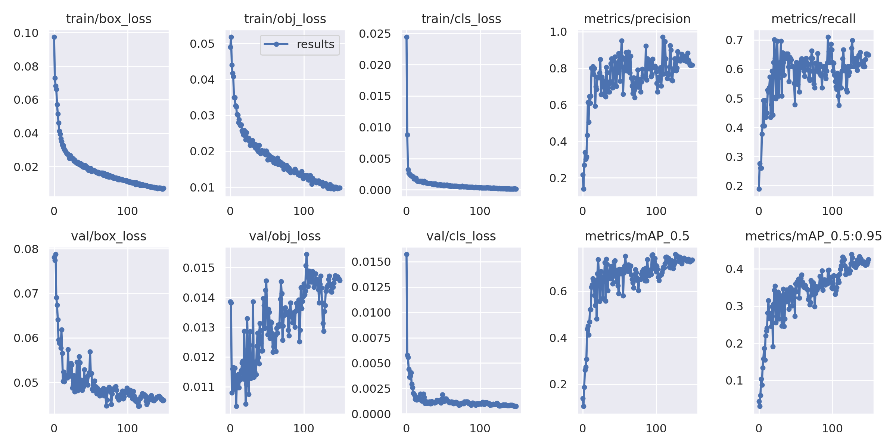
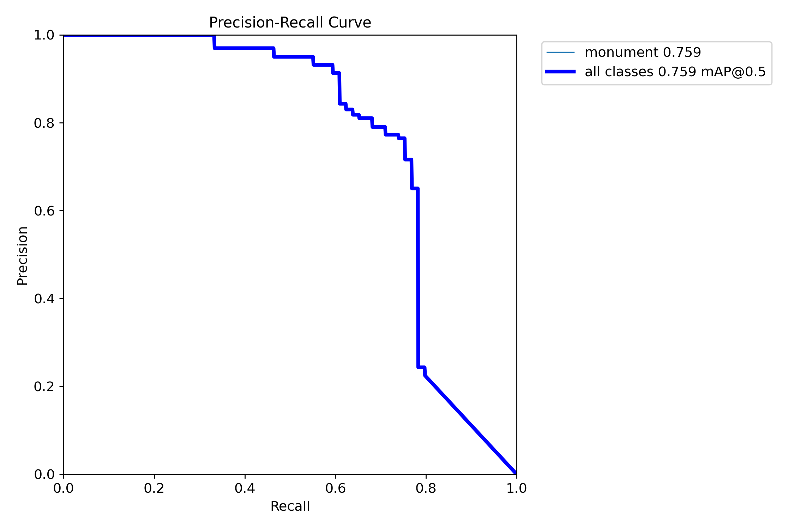
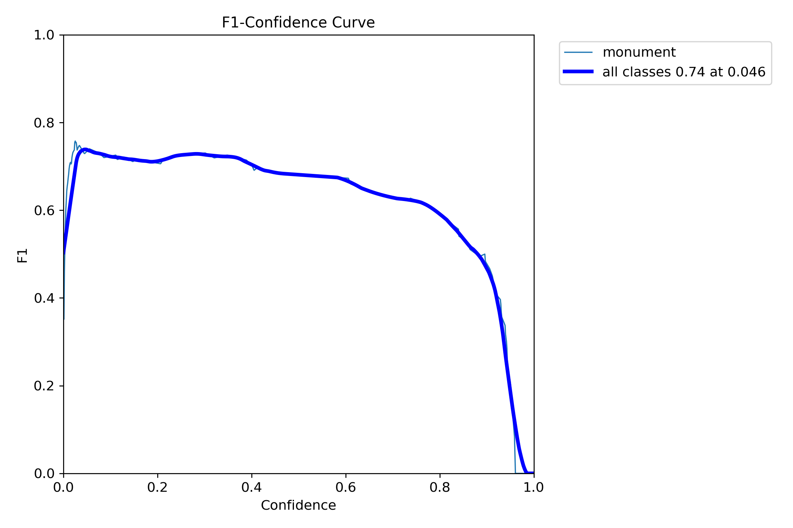
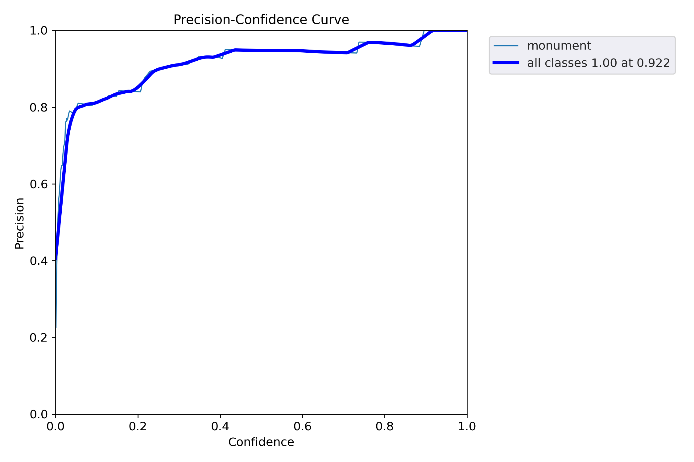
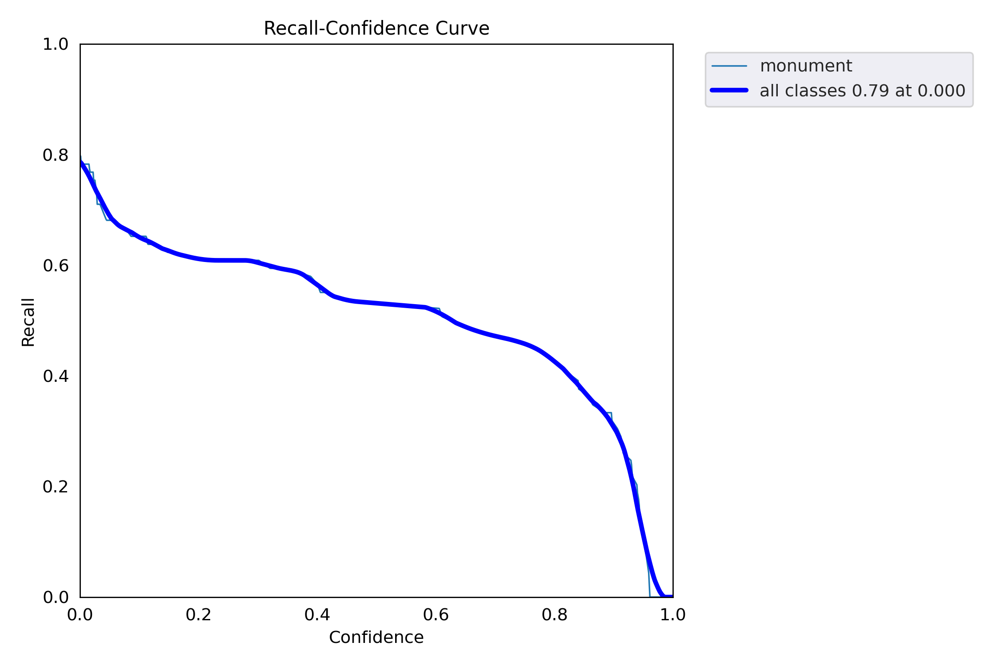
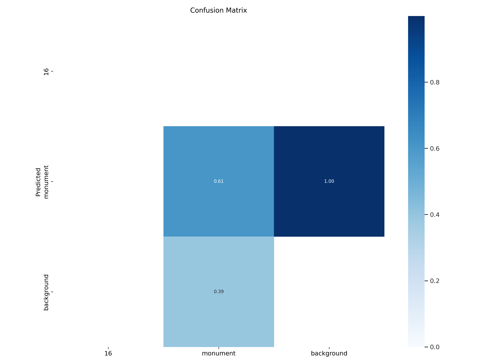

# ATEET — Monuments Detection

ATEET is a research-oriented computer-vision project for identifying monument structures in aerial and 2d imagery. It combines a static web interface with a Python inference API powered by a custom-trained YOLOv5 model.

**Live demo:** [Open ATEET Monument Detector](https://kalpasur.github.io/ATEET-Monument-Detector/)  
**Source code:** [GitHub repository](https://github.com/kalpasur/ATEET-Monument-Detector)  
**Research paper:** [Identification of Monuments from Aerial Images Using Deep Learning Techniques — ResearchGate](https://www.researchgate.net/publication/372550896_IDENTIFICATION_OF_MONUMENTS_FROM_AERIAL_IMAGES_USING_DEEP_LEARNING_TECHNIQUES)

> **Deployment note:** GitHub Pages hosts only the browser interface. Prediction requests are sent to a separately deployed Flask API. The API must be running and configured in the interface before image detection will work. The first request may take longer while the model checkpoint is downloaded and loaded.

## Contents

- [Project overview](#project-overview)
- [Research publication](#research-publication)
- [Features](#features)
- [System architecture](#system-architecture)
- [Repository structure](#repository-structure)
- [Technology stack](#technology-stack)
- [Try the web application](#try-the-web-application)
- [Run the backend locally](#run-the-backend-locally)
- [API reference](#api-reference)
- [Deployment](#deployment)
- [Model weights](#model-weights)
- [Troubleshooting](#troubleshooting)
- [Limitations and responsible use](#limitations-and-responsible-use)
- [Contributing](#contributing)
- [Citation](#citation)
- [Acknowledgements](#acknowledgements)

## Project overview

The project explores the use of deep learning for monument identification in aerial imagery, with the goal of supporting faster image review and cultural-heritage research. The associated paper compares VGG-16 and YOLOv5 in terms of detection performance, speed, and suitability for aerial/UAV imagery. The currently deployed inference application uses YOLOv5.

The web application lets a user submit an image, select a confidence threshold, and review the model's annotated output, detection labels, bounding boxes, confidence scores, and inference time.

This is an object-detection demonstration, not an authoritative heritage verification system. A predicted object should be checked by a domain expert before being used for archaeological, conservation, or other consequential decisions.

## Research publication

**Identification of Monuments from Aerial Images Using Deep Learning Techniques**

- **Authors:** Gautam Kumar Jaiswal, Renu Chaudhary, Mohit Kumar, and Srishty
- **Conference:** International Conference on Emerging Applications of Artificial Intelligence, Machine Learning and Cybersecurity
- **Year:** 2023 (June)
- **Location:** Delhi
- **Publication page:** [ResearchGate — paper details and full-text request](https://www.researchgate.net/publication/372550896_IDENTIFICATION_OF_MONUMENTS_FROM_AERIAL_IMAGES_USING_DEEP_LEARNING_TECHNIQUES)

The paper describes a monument-identification workflow using aerial/UAV imagery and compares VGG-16 and YOLOv5. For exact experimental settings, dataset composition, and reported evaluation values, consult the paper itself. This README does not add unverified accuracy or benchmark figures.

## Features

- Browser-based image upload with drag-and-drop support.
- JPG, PNG, and WEBP input, with a 12 MB upload limit in the current interface/API configuration.
- Adjustable confidence threshold (0.05–0.95; default 0.25).
- YOLOv5 inference through a Flask REST API.
- Annotated image output, predicted class names, confidence scores, bounding-box coordinates, detection count, and inference time.
- Separate frontend and backend deployments.
- CORS configuration for the GitHub Pages origin.
- Lazy model loading and model-weight download from Git LFS media URL.
- Health endpoint for checking whether the API process is responding.

## System architecture

```text
Browser
  |
  | GitHub Pages: static HTML, CSS, JavaScript
  | Upload image + confidence threshold
  v
Flask API (Render or another Python host)
  |
  | Download/load best.pt when first prediction is requested
  v
YOLOv5 v6.2 + PyTorch (CPU)
  |
  | Detections + annotated JPEG
  v
Browser displays results
```

GitHub Pages cannot run Python, Flask, or PyTorch. It serves the static frontend only; the inference API must be deployed separately.

## Repository structure

```text
ATEET-Monument-Detector/
├── .github/workflows/pages.yml   # GitHub Pages deployment workflow
├── backend/
│   ├── app.py                    # Flask prediction API
│   ├── Dockerfile                # Docker image definition
│   └── requirements.txt          # Backend Python dependencies
├── site/
│   ├── index.html                # Browser UI
│   ├── styles.css                # Frontend styling
│   ├── app.js                    # Upload and prediction logic
│   └── config.js                 # Optional shared API endpoint
├── static/
│   ├── Ateet.png                 # Project logo (copied into Pages build)
│   ├── github.png                # GitHub icon asset
│   └── style.css                 # Legacy stylesheet
├── visual/                       # Training and evaluation plots
├── thesis/                       # Paper, project presentation, workflow figure
├── mon_model.ipynb               # Model development/training notebook
├── prediction.ipynb              # Prediction notebook
├── templates/index.html          # Original Flask template
├── webapp.py                     # Original application entry point
├── best.pt                       # YOLOv5 checkpoint / Git LFS pointer in Git
├── render.yaml                   # Render Blueprint configuration
├── DEPLOYMENT.md                 # Deployment guide
├── LICENSE                       # Apache-2.0 license
└── README.md
```

## Model training and evaluation artifacts

The repository includes visual diagnostics produced during model training and validation. These figures are useful for understanding the training run, but they should be interpreted together with the dataset split, evaluation command, model configuration, and the research paper.

### Training curves and summary



### Precision–recall and confidence curves

| Evaluation plot | What it helps inspect |
|---|---|
| [Precision–recall curve](visual/PR_curve.png) | Precision/recall trade-off across confidence thresholds |
| [F1 curve](visual/F1_curve.png) | F1-score behaviour as the confidence threshold changes |
| [Precision curve](visual/P_curve.png) | Precision behaviour across confidence thresholds |
| [Recall curve](visual/R_curve.png) | Recall behaviour across confidence thresholds |
| [Confusion matrix](visual/confusion_matrix.png) | Class-level true/false prediction patterns represented by the evaluation run |

<details>
<summary><strong>View evaluation plots</strong></summary>

**Precision–recall curve**



**F1 curve**



**Precision curve**



**Recall curve**



**Confusion matrix**



</details>

### Dataset labels and qualitative predictions

| Artifact | Description |
|---|---|
| [Label distribution / label diagnostics](visual/labels.jpg) | Overview of labels used in the training run |
| [Training batch 0](visual/train_batch0.jpg) · [batch 1](visual/train_batch1.jpg) · [batch 2](visual/train_batch2.jpg) | Examples of training images and annotations |
| [Validation labels — batch 0](visual/val_batch0_labels.jpg) · [batch 1](visual/val_batch1_labels.jpg) | Ground-truth examples from validation batches |
| [Validation predictions — batch 0](visual/val_batch0_pred.jpg) · [batch 1](visual/val_batch1_pred.jpg) | Qualitative model predictions for validation examples |

These images are stored in the `visual/` directory. They are diagnostic artifacts, not a substitute for reporting reproducible numerical metrics such as precision, recall, mAP@0.5, mAP@0.5:0.95, dataset size, split strategy, and evaluation settings. Only publish numerical values that can be verified from the training logs or the associated paper.

## Research and project documents

- **Research paper:** [Identification of Monuments from Aerial Images Using Deep Learning Techniques](https://www.researchgate.net/publication/372550896_IDENTIFICATION_OF_MONUMENTS_FROM_AERIAL_IMAGES_USING_DEEP_LEARNING_TECHNIQUES)
- **PDF in repository:** [Open the paper/document PDF](thesis/123-129%2C%20Tesma0802%2CIJEAST.pdf)
- **Project presentation:** [Minor project presentation](thesis/Minor_project.pptx)
- **Model workflow figure:** [ATEET model workflow](thesis/ateet%20model%20workflow.png)
- **Model development notebook:** [mon_model.ipynb](mon_model.ipynb)
- **Prediction notebook:** [prediction.ipynb](prediction.ipynb)

The notebooks and figures are provided for project transparency and further study. Review their contents and environment requirements before rerunning them.

## Technology stack

| Component | Technology |
|---|---|
| Frontend | HTML, CSS, JavaScript |
| Static hosting | GitHub Pages |
| API | Python, Flask, Flask-CORS |
| Detection | YOLOv5 v6.2 |
| Inference framework | PyTorch / Torchvision (CPU build) |
| Image handling | Pillow, OpenCV |
| Deployment | Docker, Render |
| Model storage | Git Large File Storage (Git LFS) |

## Try the web application

1. Open the [live demo](https://kalpasur.github.io/ATEET-Monument-Detector/).
2. Expand **Inference server settings**.
3. Enter the backend API base URL, for example `https://ateet-monument-detector.onrender.com`, and select **Save endpoint**.
4. Choose a clear aerial image in JPG, PNG, or WEBP format.
5. Adjust the confidence threshold if needed and select **Run monument detection**.
6. Review the annotated image and the detections listed below it.

The endpoint is saved in the current browser's local storage. It is not automatically saved for every visitor. To set a default endpoint for everyone, edit `site/config.js`:

```js
window.ATEET_CONFIG = {
  API_BASE_URL: "https://ateet-monument-detector.onrender.com"
};
```

Commit and push the change to `main`; the GitHub Pages workflow should redeploy the frontend.

## Run the backend locally

### Requirements

- Python 3.10
- Git
- The actual YOLOv5 checkpoint `best.pt`
- CPU-compatible PyTorch and Torchvision versions matching the backend Dockerfile

### Option A — Docker (recommended)

From the repository root:

```bash
docker build -f backend/Dockerfile -t ateet-monument-detector .
docker run --rm -p 10000:10000 \
  -e MODEL_URL="https://media.githubusercontent.com/media/kalpasur/ATEET-Monument-Detector/main/best.pt" \
  -e ALLOWED_ORIGINS="https://kalpasur.github.io,http://localhost:8000,http://127.0.0.1:8000" \
  ateet-monument-detector
```

Check the API at <http://localhost:10000/health>.

### Option B — Python environment

The Dockerfile is the most reliable way to reproduce the pinned YOLOv5 and CPU PyTorch setup. If running without Docker, create a Python 3.10 virtual environment, install the PyTorch/Torchvision CPU versions shown in `backend/Dockerfile`, install `backend/requirements.txt`, clone YOLOv5 v6.2 into a local directory, and set the environment variables before starting the app.

Example for PowerShell after dependencies and YOLOv5 have been installed:

```powershell
$env:YOLOV5_REPO = "C:\path\to\yolov5"
$env:MODEL_PATH = "C:\path\to\best.pt"
$env:MODEL_URL = "https://media.githubusercontent.com/media/kalpasur/ATEET-Monument-Detector/main/best.pt"
$env:ALLOWED_ORIGINS = "https://kalpasur.github.io,http://localhost:8000,http://127.0.0.1:8000"
python -m pip install -r backend/requirements.txt
python -m flask --app backend/app.py run --host 0.0.0.0 --port 10000
```

If starting Flask from the repository root, Python import paths and the local YOLOv5 path must be configured correctly. For a consistent deployment, prefer Docker.

## API reference

The deployed example base URL is `https://ateet-monument-detector.onrender.com`. Use your own service URL if it differs.

### `GET /health`

Returns service health and whether the model has been loaded into memory.

Example response before the first prediction:

```json
{
  "status": "ok",
  "model_loaded": false,
  "device": "cpu"
}
```

A healthy response does not guarantee that the checkpoint will fit in memory or that inference will succeed; the model is loaded lazily on the first prediction.

### `POST /predict`

Send a multipart form request with:

| Field | Required | Description |
|---|---|---|
| `file` | Yes | Image file to analyze |
| `confidence` | No | Confidence threshold from 0.05 to 0.95; defaults to 0.25 |

PowerShell example:

```powershell
curl.exe -v --max-time 300 `
  -F "file=@C:\path\to\image.jpg" `
  -F "confidence=0.25" `
  https://ateet-monument-detector.onrender.com/predict
```

A successful response is JSON containing:

- `image`: base64-encoded annotated JPEG.
- `detections`: array of predicted classes, confidence values, and bounding-box coordinates (`xmin`, `ymin`, `xmax`, `ymax`).
- `inference_ms`: measured inference time in milliseconds.

Possible client errors include missing/invalid image data, unsupported confidence values, and uploads exceeding the configured limit. Server-side model-loading or inference errors should be investigated in the backend logs.

## Deployment

### Frontend — GitHub Pages

The GitHub Actions workflow in `.github/workflows/pages.yml` publishes the `site/` directory. The expected URL is:

<https://kalpasur.github.io/ATEET-Monument-Detector/>

In repository settings, ensure **Settings → Pages → Build and deployment → Source** is set to **GitHub Actions** and verify the Pages workflow succeeds.

### Backend — Render

The repository includes `render.yaml` for a Docker-based Render Blueprint. Its configuration uses:

- Dockerfile: `./backend/Dockerfile`
- Docker context: repository root
- Health check: `/health`
- `MODEL_URL`: Git LFS media URL for `best.pt`
- `ALLOWED_ORIGINS`: `https://kalpasur.github.io`
- `MAX_UPLOAD_MB`: `12`

Review the plan configured in `render.yaml` and Render's current pricing before creating or changing a hosted service. The checked-in Blueprint specifies a Standard instance; an existing dashboard service may have a different plan.

For full deployment steps, see [DEPLOYMENT.md](DEPLOYMENT.md).

### Important resource consideration

The checkpoint is approximately 173 MB on disk, but model loading and inference require additional memory for Python, PyTorch, model parameters, image tensors, and intermediate activations. A 512 MB RAM instance may be insufficient and may return a 502 if the worker is killed. A successful health check only verifies that the web process is responding; it does not validate inference. Use a host with sufficient RAM or a validated optimized deployment if the model cannot fit. Preserve the original checkpoint and validate any converted model against it before replacing the inference path.

## Model weights

The repository tracks `best.pt` using Git LFS. The backend downloads the actual binary using the GitHub media URL:

```text
https://media.githubusercontent.com/media/kalpasur/ATEET-Monument-Detector/main/best.pt
```

Do not replace this with a URL that returns a Git LFS pointer text file or an HTML page. If you change the checkpoint location, update the `MODEL_URL` environment variable. Treat model files as executable/pickle-based artifacts: only load checkpoints from sources you trust.

## Troubleshooting

| Symptom | Likely cause | What to check |
|---|---|---|
| Frontend says the API URL is missing | No endpoint configured in the browser or `site/config.js` | Set the base URL under **Inference server settings** |
| Browser cannot reach the API | Incorrect URL, service asleep/down, or CORS configuration | Open `/health`; verify `ALLOWED_ORIGINS` includes the Pages origin |
| `/health` works but `/predict` returns 502 | Backend worker may have crashed or been killed, including due to memory exhaustion | Check Render logs at the exact request time |
| Logs show YOLOv5 trying to install dependencies at request time | Dependency versions missing or the auto-install environment variable not recognized | Verify `YOLOv5_AUTOINSTALL=false` spelling and the installed dependencies in the build |
| Model URL returns a tiny file | URL returns a Git LFS pointer rather than the checkpoint binary | Use the GitHub `media.githubusercontent.com` URL and check download logs |
| Model cannot be loaded | Checkpoint/YOLOv5 revision incompatibility, missing dependency, or corrupt download | Review full backend traceback and test the checkpoint with its compatible YOLOv5 version |
| First request is slow | Model download and lazy initialization, or a cold start on the hosting service | Wait for completion and inspect logs; repeated requests may be faster if the process remains alive |
| No detections appear | The image may not contain a learned target, or the threshold may be too high | Try a clear representative image and a lower threshold; validate results visually |

## Limitations and responsible use

- Detection quality depends on training data, image resolution, viewpoint, lighting, occlusion, and domain shift.
- The confidence score is a model score, not a calibrated probability that a structure is a protected monument.
- The application should not be used as the sole basis for archaeological claims, heritage designation, security decisions, or conservation actions.
- Inference is configured for CPU and can be slow on small instances.
- The current API returns an annotated image as base64 JSON, which increases response size for large images.
- Images uploaded to the live application are sent to the configured backend for processing. Do not upload sensitive or restricted imagery to a service you do not control.
- The research paper's reported comparisons and metrics should be taken from the publication; this repository README does not assert unverified model accuracy.

## Contributing

Issues, reproducible bug reports, and improvements are welcome.

1. Fork the repository.
2. Create a feature branch.
3. Keep changes focused and document relevant configuration updates.
4. Test the frontend and API where practical.
5. Open a pull request with a clear description of the change and the tests performed.

Please do not commit credentials, access tokens, private imagery, or large datasets unless the repository's licensing and data permissions explicitly allow it.

## Citation

If you use this project or discuss the associated research, cite the publication:

> Jaiswal, Gautam Kumar; Chaudhary, Renu; Kumar, Mohit; and Srishty. “Identification of Monuments from Aerial Images Using Deep Learning Techniques.” International Conference on Emerging Applications of Artificial Intelligence, Machine Learning and Cybersecurity, Delhi, June 2023. [ResearchGate publication page](https://www.researchgate.net/publication/372550896_IDENTIFICATION_OF_MONUMENTS_FROM_AERIAL_IMAGES_USING_DEEP_LEARNING_TECHNIQUES).

## Acknowledgements

- The authors and organizers associated with the research publication.
- The Ultralytics YOLOv5 project and PyTorch ecosystem.
- GitHub Pages and Render for hosting infrastructure.

## License

This repository includes an [Apache License 2.0](LICENSE). The license applies according to its terms; third-party libraries, research material, imagery, and model/data assets may have separate terms that must also be respected.
